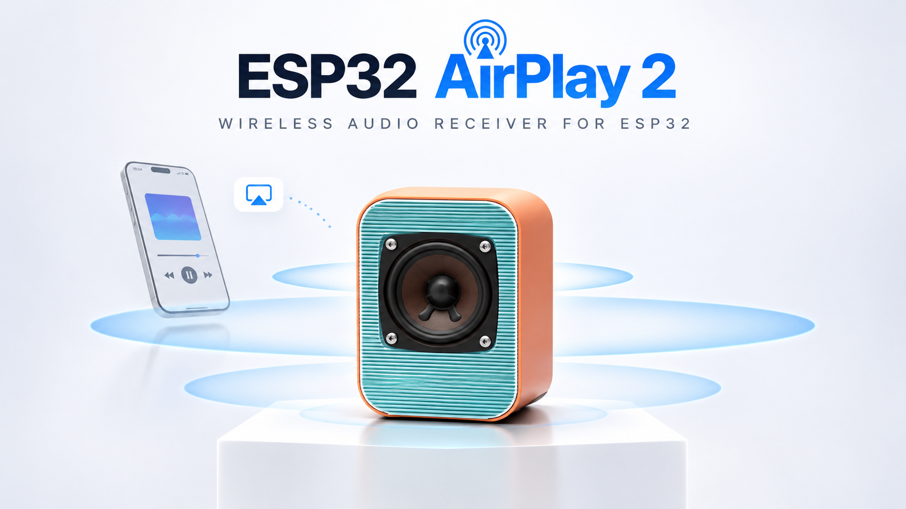
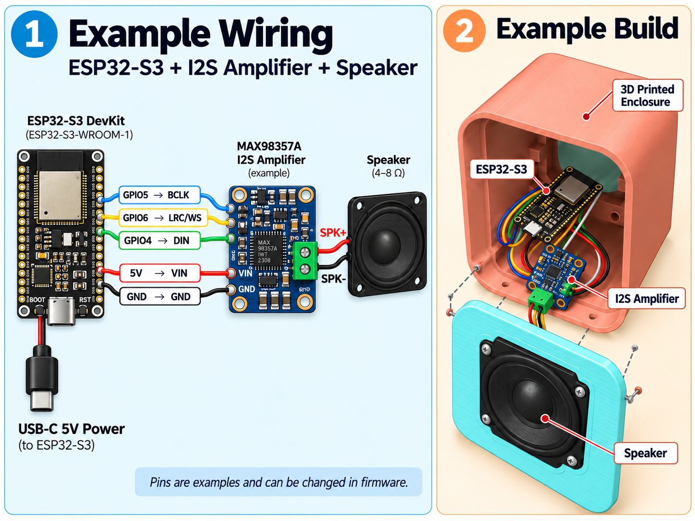
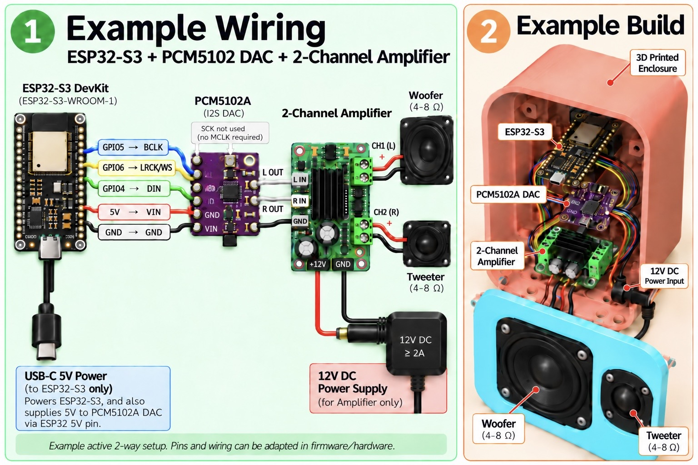
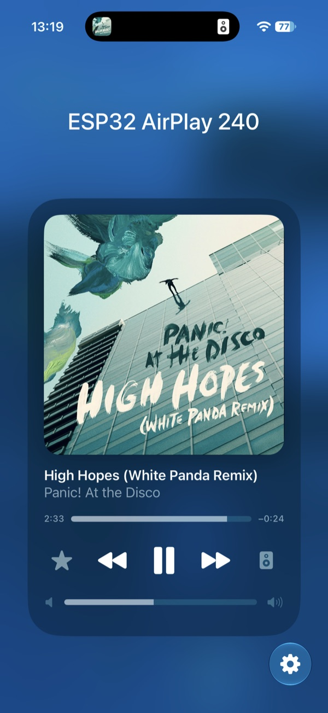
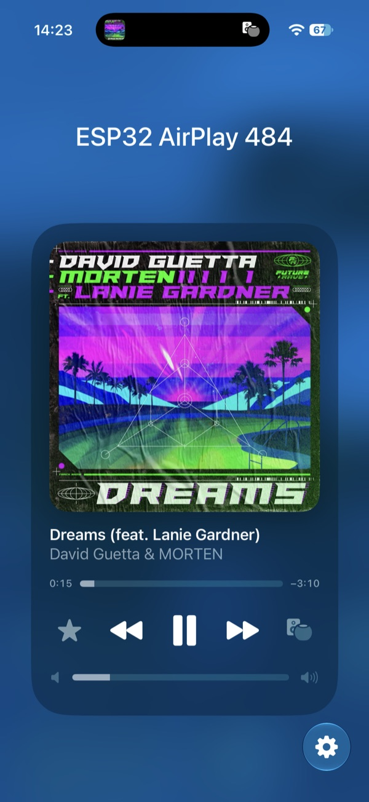

<p align="center">
  <b>Enjoying this project?</b> It is built and tested in my free time. A small
  donation helps buy test hardware and keeps the development going. Thank you! ❤️
  <br><br>
  <a href="https://www.paypal.com/donate/?business=VGY3ZM78NAL78&no_recurring=0&currency_code=EUR"></a>
</p>

<p align="center">
  <a href="images/airplay-esp32.png"></a>
</p>

# ESP32 AirPlay 2

**A wireless AirPlay 2 speaker built from a low-cost ESP32-S3 board, an I2S
DAC or amplifier and the speaker of your choice.**

The board shows up next to your HomePods in the AirPlay menu of an iPhone,
iPad, Mac or Apple TV. Play to it on its own or **group it with other
AirPlay 2 speakers**: every speaker in the group plays each sample at the same
moment, kept together by AirPlay 2's **PTP clock**. Build one for the kitchen,
one for the office and a stereo pair for the living room.

- 🏠 **Multiroom**: a real AirPlay 2 receiver, in sync with HomePods, Apple TV
  and other AirPlay 2 speakers.
- 🎵 **High-quality stereo**: lossless **ALAC 48 kHz / 24-bit** and
  44.1 kHz / 16-bit, **AAC 44.1 / 48 kHz** decoded with Fraunhofer FDK at
  32-bit output precision, followed by float DSP and 32-bit I2S output.
- 🏡 **Apple Home / HomeKit**: add the speaker to a room, see album artwork
  and track information, and control playback and volume from the Home app.
- 🔀 **Follows the source**: the I2S output switches between 44.1 and 48 kHz
  with the stream, so nothing is resampled.
- 🎛️ **Web interface**: 2 × 24-band parametric EQ / active crossover,
  loudness, stereo / mono / left / right routing, output latency with a wired
  measurement, Wi-Fi, firmware updates over Wi-Fi, live logs.
- 🔌 **Extras**: amplifier power switching, an RGB VU LED and optional
  hardware buttons (play/pause, next, previous, volume).

> [!NOTE]
> **The project is under active development.** Features, defaults and wiring
> may still change, and this README is updated with every change. See
> [Limitations](#limitations).

## Contents

- [Gallery](#gallery)
- [Apple Home / HomeKit](#apple-home--homekit)
- [How it works](#how-it-works)
- [What you need](#what-you-need)
- [Assembly and wiring](#assembly-and-wiring)
- [Installation](#installation)
- [First start](#first-start)
- [Settings](#settings)
- [Technical details](#technical-details)
- [Limitations](#limitations)
- [Troubleshooting and logs](#troubleshooting-and-logs)
- [Licenses and credits](#licenses-and-credits)

## Gallery

Click an image to open it full size.

<table>
  <tr>
    <td align="center" width="50%">
      <a href="images/wiring-max98357a.png"></a>
      <br><sub><b>Simplest build:</b> ESP32-S3 + MAX98357A I2S amplifier + one speaker</sub>
    </td>
    <td align="center" width="50%">
      <a href="images/wiring-pcm5102a-2way.jpg"></a>
      <br><sub><b>Active 2-way build:</b> ESP32-S3 + PCM5102A DAC + 2-channel amplifier, woofer + tweeter</sub>
    </td>
  </tr>
</table>

## Apple Home / HomeKit

**Add the speaker to Apple Home** and assign it to a room. During AirPlay
playback, the Home app shows album artwork and track information, with
playback and volume controls.

<table>
  <tr>
    <td align="center" width="50%">
      <a href="images/IMG_1578.jpg"></a>
    </td>
    <td align="center" width="50%">
      <a href="images/IMG_1579.jpg"></a>
    </td>
  </tr>
</table>

HomeKit integration, album artwork support, manufacturer and model can be
configured under **AirPlay Receiver** in `idf.py menuconfig`.

## How it works

1. **The board announces itself as an AirPlay 2 speaker** on your network
   (mDNS), with the audio formats it can play.
2. **The sender picks a format** for each stream and sends the audio over
   Wi-Fi: ALAC or AAC, 44.1 or 48 kHz.
3. **The board plays every sample at the moment the sender asked for**, timed
   from the group's PTP clock, after EQ, loudness and volume.
4. **Speakers never talk to each other.** Timing comes from the sender, so
   adding a room is just ticking one more speaker in the AirPlay menu.

```
          iPhone / iPad / Mac / Apple TV   (AirPlay 2 over Wi-Fi, PTP clock)
                          │
       ┌──────────────┬───┴──────────┬──────────────┐
       ▼              ▼              ▼              ▼
     ESP32          ESP32          ESP32         HomePod
    Kitchen        Office      Living room L    (any other
       │              │        Living room R    AirPlay 2
  I2S amplifier   DAC + amp      (two boards)    speaker)
       │              │              │
    speaker      woofer +        speakers
                  tweeter
```

## What you need

| Part | Notes |
|---|---|
| **ESP32-S3 board with 8 MB flash and 8 MB PSRAM** (N8R8), e.g. ESP32-S3-DevKitC-1 N8R8 | PSRAM is required: the stream buffer alone takes 6 MB. Boards without PSRAM (or with 2 MB) will not work. |
| **Audio output**, one of: | |
| &nbsp;&nbsp;• an **I2S amplifier** such as **MAX98357A** | Simplest: digital in, speaker out, about 3 W. Good for a small kitchen or desk speaker. |
| &nbsp;&nbsp;• an **I2S DAC** such as **PCM5102A** + **any analogue amplifier** | Any size: mini (PAM8403, 2 × 3 W), medium or powerful (TPA3110 / TPA3116, TDA7498…), one- or two-channel. |
| **Speaker(s)**, 4–8 Ω | One full-range driver, a stereo pair, or a woofer + tweeter pair (see [Option B](#option-b--dac--any-amplifier)). |
| **Power supply** | 5 V USB (≥ 1 A) for the ESP32-S3; a separate supply for a larger amplifier (e.g. 12 V ≥ 2 A, as your amplifier requires). |
| **Enclosure** | 3D-printed, wooden or an existing speaker box. |
| Jumper wires or a small PCB | 5 wires for the I2S connection. |

**Sender and network**

- Any Apple device with AirPlay 2: **iPhone, iPad, Mac or Apple TV**.
- A **2.4 GHz Wi-Fi** network with a good signal where the speaker stands (the
  ESP32-S3 has no 5 GHz radio).

## Assembly and wiring

> [!NOTE]
> The GPIOs below are the defaults and can be changed in `menuconfig`
> (see [Installation](#installation)).

### Option A — I2S amplifier (MAX98357A)

<a href="images/wiring-max98357a.png"></a>

| ESP32-S3 | MAX98357A |
|---|---|
| GPIO 5 | BCLK |
| GPIO 6 | LRC (WS) |
| GPIO 4 | DIN |
| 5V | VIN |
| GND | GND |

- Speaker to **SPK+ / SPK−** (4–8 Ω).
- Leave **SD** and **GAIN** unconnected (default: **(L+R)/2** mono output,
  9 dB gain). One speaker then plays both channels of the music.
- At full volume the amplifier draws up to ~1 A from 5 V: use a good USB
  supply and short power wires.

<br clear="right">

### Option B — DAC + any amplifier

<a href="images/wiring-pcm5102a-2way.jpg"></a>

| ESP32-S3 | PCM5102A |
|---|---|
| GPIO 5 | BCK |
| GPIO 6 | LCK (LRCK / WS) |
| GPIO 4 | DIN |
| 5V | VIN |
| GND | GND |
| — | SCK: not used (connect to GND, or close the module's SCK bridge) |

On the common purple PCM5102A module check the solder jumpers on the back:
**FLT = L, DEMP = L, XSMT = H** (otherwise the DAC stays muted), **FMT = L**
(I2S).

The DAC has a **left and a right output**, and the **Source mode** on the EQ
page decides what each of them carries:

| Setup | Connection | Setup on the EQ page |
|---|---|---|
| **Stereo speaker** (two drivers, left and right) | L OUT → CH1 → left speaker, R OUT → CH2 → right speaker | Source mode **Stereo** |
| **One speaker on a one-channel amplifier** | L OUT → amp input | Source mode **Mono**, so the speaker gets both channels |
| **Active 2-way (woofer + tweeter)** | L OUT → CH1 → **woofer**, R OUT → CH2 → **tweeter** | Source mode **Mono** + a crossover: low-pass on the **Left output**, high-pass on the **Right output** |
| **Stereo pair from two boards** | each board drives its own speaker | Source mode **Left input** on one board, **Right input** on the other |
| **Powered speaker / active subwoofer** | L/R OUT → its line input | Stereo, or a low-pass for a subwoofer |

**Active 2-way crossover** (one example, adjust to your drivers):

1. Open `http://<board-ip>/eq`, tick **Enable EQ and preamp** and set
   **Source mode** to **Mono**.
2. **Left Output Filters** (woofer): two **LP** filters at the crossover
   frequency (e.g. 2500 Hz), **Q 0.707** each. Two stacked Butterworth
   filters make a 24 dB/oct Linkwitz-Riley slope.
3. **Right Output Filters** (tweeter): two **HP** filters at the same
   frequency, **Q 0.707** each.
4. Tweeters are usually louder: lower the **Right preamp** until both
   drivers sound balanced. Add peak or shelf filters to correct each
   driver's response.
5. **Apply & Save**: the change is live and stored, no restart needed.

> [!WARNING]
> Always set the tweeter's high-pass **before** playing loud. Full-range
> bass destroys a tweeter in seconds. The per-output **Mute** buttons on the
> EQ page help while setting up.

**Power:** the ESP32-S3 and the DAC run from USB 5 V; a larger amplifier gets
its own supply (e.g. 12 V ≥ 2 A). Connect the grounds of the DAC and the
amplifier (the signal ground), and keep the amplifier's power wires away
from the I2S wires.

<br clear="right">

### Optional extras

| Function | Default GPIO | Notes |
|---|---|---|
| Amplifier enable / standby | 21 | switches the amplifier on while AirPlay is connected and off 5 minutes after it disconnects; active high or low |
| WS2812 RGB VU LED | 38 | the on-board LED of many DevKitC boards; VU / colour music while playing |
| Buttons: play/pause, next, previous, volume − / + | disabled | any free GPIO, to GND |
| Wired latency measurement (ADC loopback) | 7 | DAC output → coupling capacitor + bias divider → ADC pin |

## Installation

### 1. Install ESP-IDF

The firmware is built with **ESP-IDF v6.0.2**. Follow Espressif's
[installation guide](https://docs.espressif.com/projects/esp-idf/en/latest/esp32s3/get-started/index.html),
then open a terminal with the ESP-IDF environment loaded
(`source ~/esp-idf/export.sh`, or the path where you installed it).

### 2. Get the code

```bash
git clone https://github.com/Kristian8606/airplay-esp32.git
cd airplay-esp32
```

### 3. Configure (optional)

```bash
idf.py set-target esp32s3
idf.py menuconfig
```

| Menu | What you can set |
|---|---|
| **I2S Playout** | BCLK / LRCK / DATA / MCLK GPIOs, default output latency of your DAC, wired latency measurement, web admin password |
| **AirPlay Receiver** | setup Wi-Fi name and password, HomeKit pairing, artwork, speaker model, optional AAC limiter, hardware buttons |
| **Amplifier Power Control** | amplifier enable GPIO, active level, power-off delay |
| **RGB Audio/VU LED** | LED on/off, GPIO, brightness, modes |
| **AirPlay Logs and Diagnostics** | log detail |

The defaults work for the wiring above, so this step can be skipped.

### 4. Build and flash

Connect the board over USB and run:

```bash
idf.py build
idf.py -p /dev/cu.usbmodem* flash monitor
```

On Windows the port is `COMx`, on Linux usually `/dev/ttyACM0`. Flashing
keeps the saved Wi-Fi, name and EQ.

### 5. Updates

Later versions can be installed **over Wi-Fi**: on the board's main page,
**Firmware Update** → choose `build/airplay-esp32_<version>.bin` →
**Upload Firmware**. The web interface is part of the firmware and is updated
with it.

## First start

1. **Connect to Wi-Fi.** A new board opens the access point
   **`ESP32-AirPlay-Setup`**. Join it with a phone or laptop; the setup page
   opens by itself (or go to `http://192.168.4.1/`). Choose your network,
   enter the password, **Connect to WiFi**.
2. **Name the speaker.** Find its IP address in your router (or the serial
   log), open `http://<board-ip>/` and set **AirPlay Device Name**, e.g.
   *Kitchen*. Until then it is called *ESP32 AirPlay* plus a short code.
3. **Play.** On an iPhone or iPad open Control Center → the **AirPlay** icon
   and pick the speaker; on a Mac use the AirPlay menu or the Music app; on an
   Apple TV use the audio output in Control Center.
4. **Group it.** Tick several speakers in the same AirPlay menu (HomePods,
   other boards, other AirPlay 2 speakers) and they play together.
5. **Add it to Apple Home** to assign a room and access artwork and playback
   controls (see [Apple Home / HomeKit](#apple-home--homekit)).

> [!TIP]
> If your DAC or amplifier adds delay (a DSP, a soundbar input), set
> **Output Latency** on the main page so this speaker stays in sync with the
> rest of the group. With a wired loopback to GPIO 7 the board can measure it
> itself (**Measure**).

## Settings

Everything is configured in the browser at `http://<board-ip>/`.

### Main page

| Card | What it does |
|---|---|
| **Playback** | play/pause, next, previous and volume of the current AirPlay sender |
| **WiFi Network** | scan and change the network |
| **Device Settings** | the AirPlay name |
| **Output Latency** | delay of your hardware after the ESP (DAC, DSP), so all speakers in a group stay in sync; *Measure* runs a wired loopback test |
| **Firmware Update** | OTA update with a `.bin` file |
| **System** | IP, MAC, memory, firmware, uptime, reset reason, Wi-Fi network, signal, channel, PHY and BSSID; restart |
| **Reset** | **Reset HomeKit** forgets pairing and keeps Wi-Fi/audio settings; **Factory Reset** erases all saved data and restarts for Wi-Fi setup |
| **Audio EQ / System Logs / WiFi Speedtest** | links to the pages below |

### Audio EQ page (`/eq`)

| Card | What it does |
|---|---|
| **Source** | **Stereo** (L → left EQ, R → right EQ), **Mono** ((L+R)/2 → both), **Left input** or **Right input** → both outputs |
| **Loudness** | ISO 226 loudness compensation: restores bass and treble at low volume, following the volume live |
| **Left / Right Output Filters** | two independent chains of up to **24 biquad filters** each: peak, low-pass, high-pass, band-pass, notch, low shelf, high shelf; a **preamp** and a **mute** button per output |
| **Apply & Save** | applies live and stores in flash |

Filters are recalculated for the stream's sample rate (44.1 or 48 kHz), so a
crossover stays at the same frequency whatever the source.

### Other pages

- **`/logs`**: live log of the board over WebSocket.
- **`/speedtest`**: ping, download and upload between the browser and the
  board, to check Wi-Fi where the speaker stands.

**Resetting the speaker:** both reset actions ask for confirmation and stop
AirPlay before erasing data. **Factory Reset** additionally requires typing
`ERASE ALL`; it clears Wi-Fi networks, name, EQ/routing/preamps, loudness,
volume, output latency and pairing keys. After a HomeKit reset, remove the
old speaker entry from Apple Home before adding it again. The installed
firmware and its build-time defaults remain in place.

**Security:** with a **Web UI admin password** set in `menuconfig`, firmware
updates, restart, both reset actions, Wi-Fi and name changes and the latency settings and test
require the user `admin` and that password.

## Technical details

### Audio formats

The receiver advertises these formats; the sender chooses one per stream:

| Transport | Codec | Rate | Bit depth | Frames / packet |
|---|---|---|---|---|
| Realtime UDP (type 96) | ALAC | 44.1 kHz | 16-bit | 352 |
| Buffered TCP (type 103) | ALAC | 44.1 kHz | 16-bit | 352 |
| Buffered TCP (type 103) | ALAC (lossless) | 48 kHz | 24-bit | 352 |
| Buffered TCP (type 103) | AAC-LC | 44.1 / 48 kHz | F24 profile, decoded to 32-bit | 1024 |

All formats are **stereo**. 5.1 / 7.1 is not advertised; for wireless
surround from an Apple TV see the sister project
[esp32-airplay2-surround](https://github.com/Kristian8606/esp32-airplay2-surround).

- **The sender decides the format**, from the formats the speaker announces
  and from what the content offers. Music from Apple Music typically arrives as
  AAC 48 kHz; system audio, screen mirroring and many apps use realtime ALAC
  44.1 kHz.
- **Format changes mid-stream.** Every audio packet carries its format in the
  RTP SSRC. The board switches codec, bit depth or rate per packet, without a
  new SETUP, and only after the packet has authenticated. A rate change
  (44.1 ↔ 48 kHz) restarts I2S at the right moment with a short gap, and the
  timeline stays continuous.

### Signal path

1. **Decoding.** **AAC** is decoded with **Fraunhofer FDK AAC** through a
   32-bit output API: signed 32-bit straight to float, without a 16-bit step.
   **ALAC** uses Espressif's decoder; 24-bit samples also go straight to
   float.
2. **Optional AAC limiter.** The experimental FDK limiter keeps S32 output
   and compensates its lookahead in the PCM RTP timestamps: 720 frames at
   48 kHz or 661 at 44.1 kHz (about 15 ms). It is **off by default**; enable
   **Test FDK PCM limiter (S32, lookahead compensated)** in `menuconfig` for
   testing. ALAC bypasses it.
3. **DSP** in 32-bit float: source routing, EQ / crossover, loudness, volume.
   Float processing preserves headroom, but EQ or loudness can still produce
   peaks above the final output range. The AAC limiter is before these stages
   and does not protect against peaks they introduce.
4. **I2S** with 32-bit samples in 32-bit slots at the stream's rate (44.1 or
   48 kHz). Float PCM is converted to signed 32-bit with saturation before DMA.

### Synchronisation

Playback is scheduled from the sender's **PTP clock**: each packet carries
an RTP timestamp, and the board plays every sample at the time the sender
asked for. The I2S clock is fine-tuned live (fractional MCLK divider, no
stops) to follow the sender, so grouped speakers stay together over hours.
The **output latency** of your DAC or DSP is taken into account, so the sound
leaves every speaker at the same moment.

### Performance and memory

| | |
|---|---|
| Compressed stream buffer | 6 MB in PSRAM |
| Decoded audio ahead of the output | ~850 ms |
| Decode task stack | 20 KiB in PSRAM |
| Firmware size | ~2.0 MB of a 3 MiB app partition (two partitions for OTA) |

| Core 0 | Core 1 |
|---|---|
| Wi-Fi, RTSP, PTP, AAC decode / EQ, realtime ALAC receive and decode | I2S playout, ordered ALAC staging / EQ, buffered stream reader |

The FDK changes (32-bit output, hardware bit counting on the ESP32-S3,
smaller buffers and the optional S32 limiter) are listed in
[`components/fdk_aac/MODIFICATIONS.md`](components/fdk_aac/MODIFICATIONS.md).

## Limitations

- **Stereo only**; surround is a separate project (see
  [Audio formats](#audio-formats)).
- **2.4 GHz Wi-Fi only** (ESP32-S3).
- **The sender chooses the format.** Advertising ALAC 48 kHz / 24-bit does not
  mean every sender uses it; most Apple Music playback arrives as AAC.
- A switch between 44.1 and 48 kHz has a short silence while I2S is
  reconfigured.
- At the start of a session, or when the group's clock master changes (for
  example when a HomePod joins), synchronisation takes a few seconds up to
  about a minute to settle within a millisecond.
- AirPlay video (screen mirroring picture) is not supported; audio only.

## Troubleshooting and logs

| Problem | Check |
|---|---|
| The speaker does not appear in the AirPlay menu | Same Wi-Fi network as the sender; the board's IP in your router; guest networks often block AirPlay. |
| AirPlay works but the speaker cannot be added to Apple Home | Enable HomeKit and use model `AirPlaySpeaker1,1` in **AirPlay Receiver**; see [Apple Home / HomeKit](#apple-home--homekit). |
| No sound | **Mute** buttons and **Source mode** on `/eq`; PCM5102A **XSMT** jumper; wiring of BCLK / LRCK / DATA; amplifier enable GPIO. |
| Dropouts | Wi-Fi signal at the speaker (`/speedtest`, RSSI on the main page). |
| Speaker early or late in a group | **Output Latency** of that board (DSP, external processors). |
| Only one channel plays | **Source mode** on `/eq`: *Left input* / *Right input* play one channel on purpose. |

Useful lines in the serial log or at `http://<board-ip>/logs`:

| Line | Meaning |
|---|---|
| `NOW PLAYING \| AAC-LC \| 48000 Hz \| 24-bit (F24) \| stereo L/R` | AAC from the sender, decoded at 32-bit |
| `NOW PLAYING \| ALAC \| 48000 Hz \| 24-bit \| stereo L/R` | a lossless 24-bit stream |
| `NOW PLAYING \| ALAC \| 44100 Hz \| 16-bit \| stereo L/R` | realtime ALAC (system audio, mirroring, many apps) |
| `SETUP audioFormat=… -> …` | the format the sender chose for this stream |
| `AUDIO FORMAT … -> …; SSRC …` | the sender changed the format mid-stream |
| `I2S RATE 44100 -> 48000 Hz` | the output clock changed |
| `audio_status: … sync=…ms … pcm=…ms` | every 2 s: offset from the sender's clock (should stay well under ±1 ms) and decoded audio waiting for I2S |

For deeper debugging enable **AirPlay Logs and Diagnostics → Log every RTSP
request and response** in `menuconfig` (verbose; turn it off afterwards).

## Licenses and credits

- **This repository** is under the **Apache License 2.0**, Copyright 2026
  Kristian Dimitrov: [`LICENSE`](LICENSE), [`NOTICE`](NOTICE). The
  components in `components/` carry their own copy of the license and a
  `NOTICE`. The exceptions are below.
- **FairPlay setup replies** (`components/ap2_core/src/fairplay/fairplay_tables.c`)
  are fixed interop data from reverse engineering, not under the Apache
  License; see [`components/ap2_core/NOTICE`](components/ap2_core/NOTICE).
- **Fraunhofer FDK AAC** (`components/fdk_aac/fdk-aac`) is under the
  Fraunhofer FDK license, [`NOTICE`](components/fdk_aac/fdk-aac/NOTICE). The
  copy here is a **Third-Party Modified Version of the Fraunhofer FDK AAC
  Codec Library for Android**; the changes and their dates are listed in
  [`MODIFICATIONS.md`](components/fdk_aac/MODIFICATIONS.md). The license
  allows redistribution in source and binary form without copyright fees but
  **grants no patent rights**: AAC patent licenses are available through Via
  Licensing or the patent owners.
- Other components (ESP-IDF, `esp_audio_codec`, libsodium, mDNS, cJSON,
  led_strip) come through the ESP-IDF component manager under their own
  licenses.

The AirPlay 2 protocol, clock, Wi-Fi, web server and other components come
from the sister project for 5.1 / 7.1,
[esp32-airplay2-surround](https://github.com/Kristian8606/esp32-airplay2-surround).
AAC decoding through [fdk-aac](https://github.com/mstorsjo/fdk-aac).

AirPlay, Apple TV, HomePod and HomeKit are trademarks of Apple Inc. This project is not
affiliated with or endorsed by Apple.

<p align="center">
  <br>
  If this project helped you build your AirPlay speaker, please consider
  supporting it. 🙏
  <br><br>
  <a href="https://www.paypal.com/donate/?business=VGY3ZM78NAL78&no_recurring=0&currency_code=EUR"></a>
</p>
